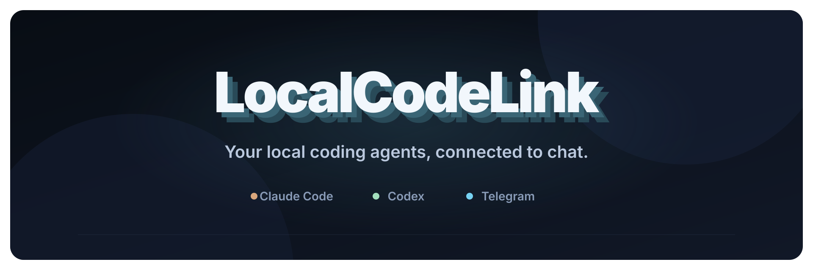

<p align="center">
  
</p>

<p align="center">
  <a href="https://github.com/joinotto/local-code-link/actions/workflows/ci.yml">CI</a> ·
  <a href="./LICENSE">Apache-2.0</a> ·
  <a href="./CONTRIBUTING.md">Contributing</a> ·
  <a href="./SECURITY.md">Security</a> ·
  <a href="./docs/ROADMAP.md">Roadmap</a> ·
  <a href="./docs/RELEASE_CHECKLIST.md">Release acceptance</a>
</p>

Control project-scoped Claude Code and Codex sessions from Telegram.

LocalCodeLink is a Node.js CLI and local background service, not a TypeScript SDK.
It is a release candidate; no public npm release or full production sign-off
is claimed.

```text
Telegram bot
├── LocalCodeLink Control
├── ledger       → Claude Code
├── website      → Codex
└── mobile-app   → Claude Code
```

Each project has one Telegram topic and one active coding task. Native session
IDs are saved so later messages resume the same Claude or Codex session.

## Features

- automatic project topic creation and reuse;
- Claude Code and Codex provider adapters;
- prompts, results, status, session reset, and interruption;
- immediate `Approve once` and `Deny` buttons;
- structured Claude and Codex questions with shared terminal/Telegram resolution;
- strict Telegram user and chat allowlists;
- no public webhook, tunnel, or desktop GUI automation.
- automatic archival of topics inactive for 90 days.

## Requirements

- macOS for the currently verified native deployment; Linux foreground mode
  and protocol tests are available, but Linux native provider acceptance is not
  signed off. Windows is not supported.
- Node.js 20.18.1 or newer (Node.js 22 is used for verification);
- authenticated `claude` and/or `codex` CLI;
- a Telegram bot token created with BotFather;
- a private forum-enabled Telegram supergroup;
- the bot added as an administrator with Manage Topics and Delete Messages.

## Quick start

One copy-and-paste line installs the CLI and starts the guided setup:

```bash
npm install --global https://github.com/joinotto/local-code-link/archive/refs/heads/main.tar.gz && local-code-link
```

The wizard lets you choose a project folder and an installed coding provider,
pairs Telegram once, and opens the project's coding session. On macOS it also
installs the background bridge. Subsequent projects need only:

```bash
local-code-link codex
# or
local-code-link claude
```

Running either provider command for the first time also starts Telegram setup
automatically. `local-code-link` without arguments remains available as a guided
launcher. Noninteractive use never starts a pairing wizard or reads a token.

Use Node.js 22 and an authenticated provider CLI before starting. If npm reports
a global-directory permission error, use a user-owned Node installation; do not
run LocalCodeLink's setup or coding sessions with sudo.

This installs directly from the protected GitHub `main` branch, not the npm
registry; no public npm publication is claimed. Each user runs their own local
bridge and supplies their own Telegram bot and authenticated provider CLIs.
This is not a shared multi-tenant hosted service. Contributors can use the
[source development instructions](CONTRIBUTING.md).

If a maintainer supplies a reviewed release archive, the equivalent install is
`npm install --global ./local-code-link-0.9.0.tgz && local-code-link`.

On first setup, paste a token from `@BotFather` into the hidden terminal prompt
(the token is not echoed). The CLI then gives you a link to
add the bot to a private Telegram group. Enable Topics in the group and send the
exact `/connect CODE` command displayed in your terminal from your real
owner/admin account. The random code belongs only to this setup attempt.
LocalCodeLink automatically discovers the group ID and your user ID,
checks group privacy and bot permissions, creates the control topic, saves
`~/.local-code-link/config.env` with mode
`0600`, and sends a test message.

No Telegram chat IDs or user IDs need to be entered manually.
The BotFather token, private forum group, and owner/admin confirmation are still
required; the bridge cannot create a bot account or grant itself permissions.
Use `local-code-link setup telegram` only when you want to rerun pairing or
replace a token. Finish pending approvals/tasks before a service reinstallation.

The launcher finds Node.js on your `PATH`; `LOCAL_CODE_LINK_NODE_BIN` can name an
explicit executable. No developer-specific home or executable path is required.
Native terminal preparation runs at install time; do not disable install scripts
for a release install. If native compilation is necessary, install your OS's
compiler/development tools first.

Use `LOCAL_CODE_LINK_HOME` for a dedicated custom state directory, or
`LOCAL_CODE_LINK_ENV_FILE` for an explicit private configuration file. Configuration
is parsed as data, not executed as shell code. Existing source-checkout `.env`
files remain readable for compatibility; rerunning setup saves the private
configuration outside the package without erasing mappings.

## Link a project

Inside the project folder:

```bash
local-code-link claude
# or
local-code-link codex
```

The command creates a topic named after the folder. Repeating it reuses the
topic and can switch the selected provider. It then opens the interactive
Codex or Claude CLI in the current terminal. If LocalCodeLink already knows the
provider session ID, it resumes that session automatically.

To create/reuse only the mapping from inside a coding session:

```bash
local-code-link claude --link-only
# or
local-code-link codex --link-only
```

This does not attach an arbitrary already-running plain session or open a
nested terminal. Reopen that session through the managed launcher for shared
terminal control. Bundled Codex/Claude linking commands use this mapping-only
mode. If two folders share a basename, pass a unique project name, for example
`local-code-link codex backend-service`.

The selected provider is the one you last linked for this project—not whichever
CLI happened to be active most recently. Close the managed session and finish
pending Telegram work before switching providers; saved Claude and Codex
session IDs are kept separately.

## Background operation

First-time macOS setup starts the background service automatically. You can close
the setup terminal once your coding session exits; the Telegram bridge remains
running while the Mac is awake and connected.

For foreground operation (including Linux's currently experimental native mode),
run `local-code-link serve` in a separate terminal.

The daemon uses Telegram long polling, so no tunnel is required.

### Background service and authentication

On macOS:

```bash
local-code-link service install
local-code-link service status
local-code-link doctor
```

Stop a temporary foreground `serve` process with Ctrl+C before installing or
starting the background service. A private process lease prevents two bridge
services from owning the same state directory. If another application polls
the same Telegram bot, LocalCodeLink reports the conflict rather than competing.

Before starting the daemon and before background Claude runs, LocalCodeLink
reads allowlisted provider settings from your own zsh/bash login shell. This
lets an inactive Bedrock/Vertex/API-authenticated Claude session use the same
configuration as your terminal. Authentication values stay in memory, not in
project history, the launchd plist, or diagnostic output. Native credential
stores and AWS profiles continue to be used by the provider itself.

Your shell startup must finish without requiring interactive input. Provider
settings exported only in a one-off terminal, but absent from shell startup or
native credential configuration, cannot be recreated after that terminal closes.
Unsupported shells or failed environment capture produce an actionable error
instead of silently switching providers. Refresh expired native credentials in
your normal authenticated shell/account.
The same in-memory capture includes proxy settings from your trusted shell.
Credential-bearing proxy URLs are not saved in the launchd plist.

New coding child processes do not inherit the Telegram bot token. Reopen
managed coding terminals after a bridge upgrade; already-running processes do
not automatically load updated relay code or sanitized environments.
Finish pending approvals and Telegram/background work before reinstalling the
service. Reinstallation loads the updated service definition; it does not
silently keep an old package/configuration path.

Project topic commands:

- normal text prompts the selected provider;
- `/status` shows provider and task state;
- `/new` clears the saved provider session;
- `/interrupt` interrupts the active task.
- `/delivery` lists held Telegram deliveries;
- `/retry-delivery ID` explicitly retries a held message without rerunning the
  coding task or approving anything. Inspect Telegram first: uncertain or
  partially sent messages can be duplicated by a manual retry.

The control topic supports `/projects`.

## Unlink a project

Inside the project folder:

```bash
local-code-link unlink
# Or identify a linked project explicitly:
local-code-link unlink ledger
```

The CLI asks for confirmation because unlink permanently deletes the project's
Telegram topic and **all messages in it**. For automation, use
`local-code-link unlink ledger --confirm`.
You can also send `/unlink` in the project's Telegram topic and confirm the
delete button.

Unlink revokes Telegram control, invalidates its pending approval buttons, attempts to cancel
Telegram-originated work, deletes the topic, and removes the project's
LocalCodeLink mapping, approval history, and tracked requests. It keeps project
files, native Codex/Claude session history, and local-only coding tasks. The
shared bot, group, control topic, credentials, and other projects are unchanged.

The bot needs the Telegram **Delete Messages** administrator permission.
If topic deletion fails, access stays revoked and the CLI reports incomplete
cleanup; fix the error and rerun unlink. No success is reported until Telegram
cleanup succeeds. If task cancellation fails, the command warns that already
accepted work may still run.

Linking again creates a new topic and a fresh LocalCodeLink mapping. It does not
restore deleted Telegram messages or the removed bridge session mapping.

## Live Codex sessions

`local-code-link codex` connects the terminal to the shared Codex daemon.
Telegram sends to that same session instead of spawning a second writer.
Idle sessions start a Telegram request immediately; busy sessions keep it queued
until the current turn finishes. Only Telegram-originated results are sent back.
Queued request tracking survives a LocalCodeLink service restart.
If the shared connection is unavailable, the bridge reports an error instead of
silently opening a competing Codex session. A plain `codex` session without the
shared connection is not a supported live display target.

## Approvals

Managed Claude and Codex sessions pause when permission is required.
LocalCodeLink immediately posts the request in the mapped topic with
`Approve once` and `Deny` buttons.

Decisions are single-use, project-scoped, user-attributed, and expire after
15 minutes. Telegram-only Claude runs fail closed on delivery failure. In an
interactive session, the terminal panel remains usable if Telegram is unavailable.

Start interactive Codex through `local-code-link codex`. A private local Unix
socket relay mirrors Codex's native approval requests without blocking the CLI
prompt. Approve or deny in either Codex or Telegram; the first decision wins.
Telegram edits the original request to show the outcome and removes its buttons.
The provider's resolution event closes the native Codex prompt. No second
approval is required. Both interfaces show the decision and actor: Telegram
identifies the numeric user ID (and name when available), and the CLI displays
a `LocalCodeLink` status notice. This display notice is local to the CLI; it
does not inject a prompt or message into the model's conversation.

The launcher explicitly sets Codex's working directory to the folder where you
ran the command. It resumes a saved session only after verifying that its
canonical working directory matches this project exactly. Missing or
wrong-folder bindings start a new session here; other native sessions are
never deleted or moved. A connection failure stops the launch rather than
guessing a session. The relay also prevents resuming or forking another
project's session through this scoped terminal, and records newly started
session IDs without depending on hook approval.

An already-open Codex window must be closed and reopened with
`local-code-link codex` once to enable this relay. The lifecycle hook still tracks
session IDs. Launching through LocalCodeLink removes its legacy blocking
`PermissionRequest` hook while preserving other hooks; old copies of that hook
also return immediately.
Review local hooks once with `/hooks` if Codex asks. A Telegram service restart
does not disconnect the per-terminal relay.

Native CLI approval remains usable if Telegram is slow, unavailable, or the
project has been unlinked. A late second response is ignored, including a CLI
keypress that was already in flight when Telegram resolved the request.

Telegram-originated queued turns with no open terminal use the shared daemon's
approval protocol instead. Native Codex windows not launched through the relay
cannot provide the same exact CLI-decision attribution.

Local iTerm activity is not mirrored to Telegram. Responses to Telegram prompts
and approval requests are posted in the project topic.

### Codex questions

The relay forwards `item/tool/requestUserInput` and its older
`tool/requestUserInput` form. A single question offers Telegram option buttons.
Custom answers are accepted when the provider allows them. For a request with
multiple questions, answer all IDs in one message:

```text
/answer REQUEST_ID {"framework":"React","package_manager":"npm"}
```

Question IDs and the answer structure are preserved exactly; the first complete
valid CLI or Telegram response wins. The other interface resolves and buttons
are removed. Unknown, incomplete, expired and wrong-topic answers are rejected.
Questions flagged `isSecret` remain terminal-only; their answer values are not
saved in bridge history. Unsupported request types are not implicitly approved.

Network approvals display their destination. Proposed file-change content is
included when provided by the native protocol; if the preview is unavailable,
approval stays in the native terminal instead of granting unseen changes.
## Live Claude sessions

Start Claude through `local-code-link claude`. This opens the real Claude CLI
inside an owned terminal relay; no Grok connector, native channel, new bot token,
or Anthropic account change is required. It works with the tested Amazon Bedrock
configuration. A previously opened plain `claude` session must be closed and
reopened through this command once.

- Telegram prompts enter the same terminal session using a bounded paste, not a
  competing background writer.
- Busy local turns and unsent terminal drafts hold remote prompts in the queue.
  iTerm focus/cursor/capability responses are ignored, not treated as drafts.
  Use `/status` in the project topic to see whether the live bridge is waiting
  for startup, an active turn, an approval, or a local draft.
  Submit a real draft or clear Claude's input with Ctrl+U before queued messages
  can run. Recalling prompt history is treated as a draft; Escape alone is not
  assumed to clear text.
- Only Telegram-originated turn results return to Telegram. All managed permission
  requests and `AskUserQuestion` questions are forwarded.
- A stopped session resumes its saved UUID only after verifying exact canonical
  project-folder metadata. If no UUID was saved, the latest verified session from
  this project can be selected; no global `--continue` is used.
- A private project/generation-scoped socket and ownership lock prevent duplicate
  managed terminal launches. Different projects can run in parallel.
- `/interrupt` cancels the active turn, not the whole interactive Claude process.
- Queued terminal messages and result outboxes survive a Telegram daemon restart.

### Shared terminal approvals and questions

Claude's normal interface stays intact. While approval is pending, LocalCodeLink
temporarily displays a panel showing the complete action:

```text
[a] Approve once   [d] Deny   [Esc] Deny
```

Telegram shows the same request with buttons. Both interfaces share a
first-writer decision claim. The hook returns that single-use decision to Claude;
no permanent permission rules are created. The other interface closes its
request, Telegram removes its buttons, and the native terminal displays the
decision's source and actor.

For structured questions, enter an option number or custom answer in the panel.
Telegram offers option buttons, or `/answer REQUEST_ID your answer`.
Multi-select answers can be entered as comma-separated option labels.
Large tool arguments are sent separately in full before Telegram decision
buttons appear. Permission expiry, interruption, session closure, and unlink
invalidate pending buttons.

The implementation uses Claude's supported command hooks rather than its
provider-restricted native channels. Review the LocalCodeLink hooks with `/hooks`
if Claude prompts you. Do not disable hooks in a managed session.
Native provider deny rules and security policy still apply; this bridge is not
a filesystem sandbox.

### Verification

```bash
npm test
# Real streaming permission denial + exact-session resume (harmless printf):
node scripts/verify-claude-live.mjs
# Inactive/provider authentication with credentials removed from the parent:
node scripts/verify-claude-live.mjs --background-env
# Real interactive terminal, isolated from your project:
node scripts/verify-claude-live.mjs --native
# Actual Telegram callbacks + native Claude; creates a temporary project topic:
node scripts/verify-claude-telegram-live.mjs
# Automated terminal-panel decisions, restricted to harmless fixture commands:
node scripts/verify-claude-telegram-live.mjs --cli-decisions
# Actual shared Codex server, questions, command denial and reconnect/resume:
node scripts/verify-codex-live.mjs
# Actual human Telegram question and approve/deny callbacks:
node scripts/verify-codex-live.mjs --telegram
# Read-only verification of real human prompts after closing test sessions:
node scripts/verify-inactive-telegram.mjs CLAUDE_TEST_PROJECT CODEX_TEST_PROJECT
```

The live Telegram test asks for Approve once, Deny, and a framework answer. It
uses the existing bot and daemon, never fabricates callbacks or grants persistent
permissions. It retains its temporary topic so results can be inspected; use
the reported `/unlink`/CLI command to remove it.

Managed native approval/denial, structured answers, result delivery, and button
cleanup have been exercised with the owner's actual Telegram bot and Bedrock
Claude CLI. Protocol/fixture tests also cover races, cross-project routing,
queued follow-ups, unlink, and large arguments. This is not a claim that every
provider version or every operating-system configuration has been tested.

### Remaining limitations

An arbitrary already-running plain Claude terminal cannot be retroactively
attached; reopen through the wrapper. MCP elicitation forms, sandbox network
prompts that do not fire `PermissionRequest`, and every third-party CLI version
are not covered by the shared panel. Plain-text questions follow ordinary
conversation routing; structured remote questions use `AskUserQuestion`.

After an ambiguous terminal-submission crash, the bridge does not silently
replay instructions that might already have run. Inspect the native session
before retrying.

### Reliability and release scope

Accepted prompts are persisted before dispatch and incoming update IDs are
deduplicated. Telegram offsets are checkpointed after handling. Queued Claude
work and result outboxes survive daemon restarts. Interrupted background work
is reported and not replayed automatically; still-running orphan processes are
not replaced by a competing writer. The shared Codex connection reconnects and
periodically recovers outstanding project queues.

Codex transcript watching reads bounded incremental chunks rather than the
whole history on every poll, and allows for long pauses such as sleep/wake.
Failed Telegram result delivery remains queued for retry. An ambiguous HTTP
response can still cause duplicate notification/result delivery, because
Telegram has no exactly-once send primitive; approval claims prevent duplicate
execution authorization.

The live provider deployment tested here is macOS with Bedrock-authenticated
Claude, authenticated Codex, and Telegram. Hosted macOS/Linux CI passed all
172 regression tests, clean archive installation, package inspection and
dependency audit checks for the initial source revision. These jobs do not
certify live provider behavior on Linux. Actual hardware sleep/wake, long-lived
credential expiry and other OS/provider configurations remain deployment checks,
not blanket guarantees. See [SECURITY.md](SECURITY.md) and
[release checklist](docs/RELEASE_CHECKLIST.md).

Live acceptance checks also cover deployed daemon restart during pending
approvals, an isolated 60-second Telegram transport outage, and Bedrock
credential rejection/recovery. These are bounded checks, not evidence that
every possible failure or provider version is supported. The checklist includes
repeatable live commands and the remaining owner-controlled acceptance steps.

The experimental MCP-channel adapter remains internal, but is not used by the
default launcher and is not production-verified for third-party providers.

## Security

- Use a private supergroup.
- Allow only trusted numeric Telegram user IDs.
- Never commit `.env` or the BotFather token.
- Keep provider sandboxing and approval prompts enabled.
- LocalCodeLink never creates permanent provider permission rules.

## Release verification

```bash
npm ci
npm test
npm audit --omit=dev --audit-level=high
npm run test:package
npm run check:release
```

The package test installs the actual tarball in an isolated temporary directory
and verifies both command aliases, spaced paths, native PTY support and bundled
integrations. `check:release` checks licensing, dependency locking, bundled
integrations, private files, personal paths and credential-shaped text. Passing
it is package readiness, not proof of hardware/provider/hosted-CI acceptance.
Hosted CI has passed for the initial source revision; deployment acceptance
remains a separate release gate. npm publication remains disabled;
see [release preparation](docs/RELEASING.md).

`npm run test:sleep` prepares three isolated Codex states and prints a durable
evidence directory. Sleep only after the final ready message, then wake the Mac
after at least 15 seconds. The `summary.json` must say `passed`; a readiness
message, expired active command, or missing report is not a pass. Keep reports
private and archive them before temporary-file cleanup. Claude hardware
acceptance remains a separate check.

## Inspiration

Repository conventions were adapted from `joinotto/opensource`. Its common
scaffold was merged without replacing LocalCodeLink's CLI implementation;
required attribution is retained in [NOTICE](NOTICE).

LocalCodeLink independently implements patterns observed in CCGram, Agent
Relay, and Ductor. Those remain separate upstream projects under their
respective licenses.

## License

Apache-2.0. Copyright 2026 Anurag Patel (geekfarmer).
See [LICENSE](LICENSE) and [NOTICE](NOTICE).
